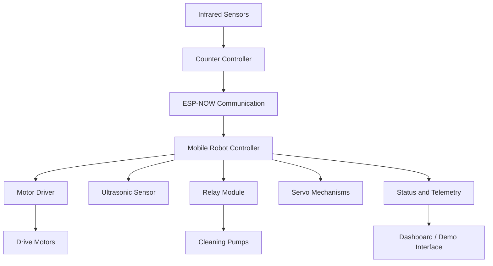
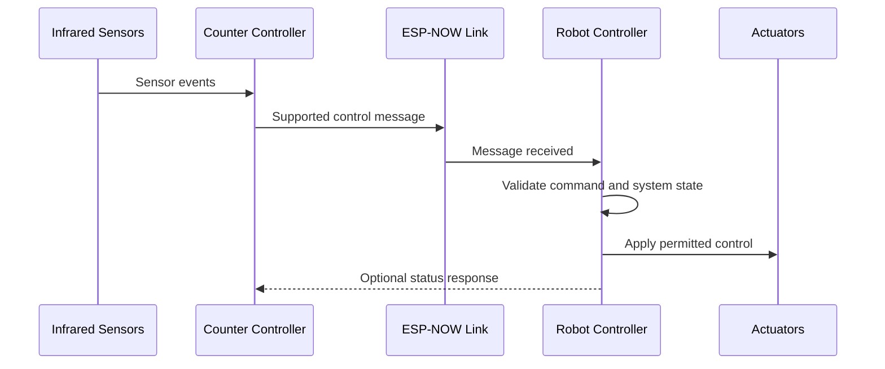

# AWC | Automatic Washroom Cleaner

<p align="center">
  <svg xmlns="http://www.w3.org/2000/svg" width="320" height="150" viewBox="0 0 320 150" role="img" aria-label="AWC Automatic Washroom Cleaner logo">
    <defs>
      <linearGradient id="awc-blue" x1="0" y1="0" x2="1" y2="1">
        <stop offset="0%" stop-color="#38bdf8"/>
        <stop offset="100%" stop-color="#2563eb"/>
      </linearGradient>
    </defs>
    <rect x="5" y="5" width="310" height="140" rx="22" fill="#0f172a"/>
    <g stroke="url(#awc-blue)" stroke-width="4" stroke-linecap="round" stroke-linejoin="round">
      <rect x="27" y="39" width="65" height="56" rx="13" fill="#172554"/>
      <path d="M59.5 26 V39 M44 57 H75" fill="none"/>
      <circle cx="46" cy="72" r="4" fill="#38bdf8" stroke="none"/>
      <circle cx="73" cy="72" r="4" fill="#38bdf8" stroke="none"/>
      <path d="M40 95 L33 111 M79 95 L86 111 M44 111 H75" fill="none"/>
    </g>
    <text x="108" y="69" font-family="Arial,Helvetica,sans-serif" font-size="36" font-weight="700" fill="#f8fafc">AWC</text>
    <text x="110" y="90" font-family="Arial,Helvetica,sans-serif" font-size="9" letter-spacing="1" fill="#cbd5e1">AUTOMATIC WASHROOM</text>
    <text x="110" y="104" font-family="Arial,Helvetica,sans-serif" font-size="9" letter-spacing="1" fill="#cbd5e1">CLEANER</text>
  </svg>
  <br/>
  <strong>Autonomous Robotics for Smarter Washroom Hygiene</strong>
  <br/>
  A sensor-integrated mobile cleaning robotics project
</p>

---

## Overview

**AWC (Automatic Washroom Cleaner)** is a robotics project focused on automating selected washroom-cleaning operations using embedded systems, sensors, wireless communication, and electromechanical mechanisms.

The project combines ESP32 and ESP8266 microcontrollers with motor drivers, infrared sensors, ultrasonic sensing, pump-based liquid dispensing, relay modules, and servo mechanisms.

AWC has evolved through multiple hardware and firmware iterations, with a focus on making the system modular, maintainable, and suitable for further experimentation.

The project brings together mechanical construction, embedded programming, electronics, communication protocols, and application-level visualization in a practical robotics prototype.

> **Project objective:** Explore how affordable embedded systems and mobile robotics can help automate repetitive cleaning tasks.

## Table of Contents

- [Project Overview](#overview)
- [The Problem](#the-problem)
- [Our Approach](#our-approach)
- [Features](#features)
- [Achievements](#achievements)
- [System Architecture](#system-architecture)
- [Hardware Components](#hardware-components)
- [Software Stack](#software-stack)
- [Operating Workflow](#operating-workflow)
- [Communication Architecture](#communication-architecture)
- [Hardware Subsystems](#hardware-subsystems)
- [Repository Structure](#repository-structure)
- [Setup and Installation](#setup-and-installation)
- [Configuration](#configuration)
- [Testing and Validation](#testing-and-validation)
- [Safety](#safety)
- [Engineering Challenges](#engineering-challenges)
- [Roadmap](#roadmap)
- [Limitations](#limitations)
- [Contributing](#contributing)
- [Acknowledgements](#acknowledgements)
- [License](#license)

---

## The Problem

Washroom cleaning is a repetitive maintenance task that requires time, physical effort, and consistent execution.

Automating parts of this process presents several engineering challenges:

- Coordinating movement and cleaning mechanisms.
- Detecting relevant events using inexpensive sensors.
- Communicating between multiple microcontrollers.
- Managing motors, pumps, and servos with different power requirements.
- Detecting obstacles and responding safely.
- Building a maintainable system using accessible components.

Commercial cleaning robots can be expensive or difficult to adapt to educational environments. AWC explores a smaller-scale alternative that can be studied, modified, and improved using commonly available electronics.

## Our Approach

AWC divides the problem into smaller subsystems.

**Mobile robotics:** A motorized chassis provides the platform for movement.

**Sensor integration:** Infrared sensors support entry/exit counting, while ultrasonic sensing can be used for obstacle detection.

**Wireless communication:** ESP-NOW allows supported ESP32 and ESP8266 devices to exchange control messages without requiring a conventional Wi-Fi router.

**Cleaning actuation:** Pump modules and relay-based switching control liquid dispensing, while servos operate mechanical components.

**Application visualization:** A dashboard concept provides a way to demonstrate system status and selected operational information.

The separation of responsibilities makes the project easier to debug and provides a foundation for future improvements.

---

## Features

### Mobile robotics

- Motorized mobile platform.
- DC motor control through an H-bridge driver.
- Separate controller logic for sensing and movement.
- Expandable sensor architecture.

### Sensor integration

- Infrared entry/exit counting subsystem.
- Two-sensor detection logic.
- Ultrasonic distance sensing for obstacle detection.
- Support for further sensor integration.

### Wireless communication

- ESP-NOW communication between compatible controllers.
- Wireless operation without a conventional Wi-Fi access point.
- Support for a serial START/STOP fallback in applicable firmware revisions.
- Modular separation between communication and actuation logic.

### Cleaning mechanisms

- Pump-based liquid dispensing.
- Relay-controlled pump switching.
- Servo-based mechanical actuation.
- Expandable cleaning-control logic.

### Demonstration interface

The project's dashboard concept supports visual demonstration of information such as:

- Robot status.
- Path visualization.
- Counting information.
- Cleaning progression.

Displayed information depends on the interface and telemetry implemented in the particular build. A visual simulation should not be interpreted as confirmation of a physical action unless the controller provides corresponding feedback.

---

## Achievements

AWC has progressed through development and competition demonstrations.

### Venad Sahodaya competition

- **Award:** Second Prize, Junior Working Model.
- **Prize:** ₹1,500.
- **Team:** The Clean Coders.

The project was presented with its hardware and application demonstration. The judges discussed practical deployment, sensor usage, and how the system could be applied in real environments.

### School Innovation Marathon

AWC reached finalist status after progressing through three levels of the competition.

These milestones provided opportunities to demonstrate the prototype, communicate the engineering concept, and identify areas for further improvement.

---

## System Architecture

The following diagram illustrates the logical relationships between AWC's major subsystems.



This is a conceptual architecture. Exact connections depend on the firmware and hardware revision.

### Subsystem responsibilities

| Subsystem | Responsibility |
|---|---|
| Counter controller | Reads infrared sensors and manages counting logic |
| Communication layer | Transfers supported messages between controllers |
| Mobile controller | Coordinates movement and supported cleaning operations |
| Motor driver | Controls the connected drive motors |
| Ultrasonic sensor | Provides distance measurements |
| Relay module | Switches the pump power circuit |
| Servo mechanisms | Provide controlled mechanical movement |
| Dashboard | Displays available status and demonstration information |

---

## Hardware Components

The following list describes the project's known hardware architecture. Exact quantities and configurations can vary between prototypes.

| Component | Purpose |
|---|---|
| ESP32 development board | Mobile robot controller |
| ESP8266 NodeMCU | Counter/controller subsystem in the relevant build |
| TT geared DC motors | Robot movement |
| L298N motor driver | DC motor direction control |
| Infrared sensor modules | Entry/exit detection |
| Ultrasonic distance sensor | Obstacle detection |
| DC pumps | Liquid dispensing |
| Two-channel relay module | Pump switching |
| Servo motors | Mechanical actuation |
| Voltage converter | Supply voltage regulation |
| Batteries or external supply | System power |
| Chassis and mounting hardware | Mechanical structure |
| Wires and connectors | Electrical interconnections |
| LEDs and supporting electronics | Status indication and auxiliary functions |

### Revision-dependent hardware

Earlier experiments included a Raspberry Pi-based controller and TCP communication. These belong to earlier architectural iterations and should not be assumed to be part of the current ESP-NOW-based implementation.

Additional components may be introduced as the design evolves.

### Design philosophy

AWC uses accessible components to simplify prototyping, repair, and experimentation.

The system is intended to remain modular so that individual components can be replaced or upgraded without redesigning the entire robot.

---

## Software Stack

| Technology | Purpose |
|---|---|
| Arduino framework | Microcontroller firmware development |
| C/C++ | Embedded programming |
| ESP32 platform | Mobile robot control |
| ESP8266 platform | Counter/controller functionality |
| ESP-NOW | Wireless communication |
| ESP32Servo or compatible library | Servo control |
| GPIO | Sensor inputs and actuator outputs |
| Serial communication | Debugging and supported fallback control |
| HTML, CSS, and JavaScript | Dashboard technologies, where applicable |
| Mermaid | Documentation diagrams |

### Firmware responsibilities

The firmware coordinates:

- Sensor initialization and sampling.
- Infrared detection and counting.
- Wireless communication.
- Command validation.
- Motor control.
- Pump and relay switching.
- Servo actuation.
- System state management.
- Diagnostic output.

The dashboard is a presentation layer. Physical operations must remain under the control of the embedded system and its safety logic.

---

## Operating Workflow

The exact sequence depends on the firmware revision. The following describes the intended subsystem workflow.

### 1. Initialization

The controllers initialize their GPIO pins, sensors, communication interfaces, and supported actuators.

The mobile controller prepares its motor and cleaning-control subsystems.

### 2. Sensor monitoring

The counter controller reads its infrared sensors.

Two-sensor event ordering can be used to distinguish the direction of passage, provided the sensor arrangement and event-processing logic support it.

### 3. Communication

The counter/controller sends supported messages to the mobile robot through ESP-NOW.

Both devices must use compatible wireless settings and message formats.

### 4. Movement

The mobile controller sends direction signals to the motor driver.

The driver controls the motors according to those signals. Actual movement direction depends on motor wiring and the configured pin mapping.

### 5. Obstacle sensing

The ultrasonic sensor measures the distance to nearby objects.

The controller can use those measurements to implement obstacle detection and movement restrictions.

### 6. Cleaning actuation

The controller operates the supported pump and servo mechanisms.

The relay switches the pump circuit, while the servo positions the associated mechanical component.

### 7. Monitoring

Available system information can be displayed in the demonstration interface.

The displayed status should be based on actual controller data wherever possible.

### 8. Stop and reset

The system transitions to its configured stopped or idle state when the applicable operating conditions are met.

Completion criteria, timeouts, and reset behavior must be defined in the relevant firmware.

---

## Communication Architecture

AWC uses ESP-NOW for wireless communication between compatible ESP32 and ESP8266 controllers.

ESP-NOW is a connectionless communication protocol provided by Espressif. It is useful for exchanging small messages between embedded devices without relying on a conventional wireless access point.

### Why ESP-NOW?

- No conventional Wi-Fi router is required for ESP-NOW peer communication.
- Small control messages can be exchanged between compatible devices.
- Communication logic can be separated from motor-control logic.
- The protocol is suitable for compact embedded-system architectures.

### Communication flow



The response shown in this diagram is optional and depends on the implemented firmware.

### Configuration requirements

Before enabling communication, verify:

- Both boards support the selected ESP-NOW implementation.
- Peer addressing or broadcast configuration is correct.
- Both devices use compatible wireless channel settings.
- Packet structures and data types match.
- Initialization succeeds on both controllers.
- Received commands are validated before use.

The project has used channel 1 in an ESP-NOW configuration. Both devices must be configured consistently with the selected channel.

### Reliability considerations

Wireless communication is not guaranteed to deliver every message.

A robust implementation should consider:

- Communication timeouts.
- Message validation.
- Duplicate-command handling where necessary.
- Defined behavior when communication is interrupted.
- A safe stopped state when required messages are unavailable.

The robot should not continue uncontrolled movement merely because a previous movement command was received successfully.

---

## Hardware Subsystems

### Motor control

The L298N provides H-bridge control for compatible DC motors.

The microcontroller supplies logic signals to the driver, while the motor supply provides the required power.

Before operation, verify the driver's current limits, voltage drop, heat dissipation, motor compatibility, and wiring.

### Infrared counting

The counting subsystem uses two infrared sensors.

A two-sensor arrangement can identify event sequences and infer direction when the sensors are positioned appropriately.

Reliable counting requires:

- Correct sensor alignment.
- Consistent event detection.
- Appropriate event ordering.
- Filtering of repeated or noisy detections.
- Testing under realistic conditions.

Counting accuracy should be measured rather than assumed.

### Ultrasonic sensing

The ultrasonic sensor provides distance measurements for obstacle detection.

Readings can be affected by object shape, angled surfaces, soft materials, sensor positioning, and environmental conditions.

A single measurement should not be treated as proof that a path is clear.

### Pump and relay control

The pump subsystem uses relay-based switching.

The relay module and contacts must be rated for the pump's operating current and startup surge.

The microcontroller should control the relay input rather than power the pump directly from a GPIO pin.

The pump circuit should use an appropriate supply and suitable electrical protection.

### Servo control

Servo mechanisms provide controlled angular movement.

The supply must support the servo's voltage and current requirements without causing controller resets.

A suitable regulated supply and common reference ground are generally required for conventional servo-control wiring.

If servo movement causes brownouts, investigate supply capacity, wiring resistance, and current demand before changing software timing.

### Power management

AWC combines logic electronics with motors, pumps, and servo mechanisms that may have significantly different current requirements.

The power architecture should account for:

- Logic voltage requirements.
- Motor and pump operating current.
- Servo startup and stall current.
- Regulator capacity.
- Common-ground requirements.
- Wiring and connector ratings.
- Noise and voltage transients.

A stable power system is essential for reliable operation.

---

## Repository Structure

A suggested organization for the project is shown below. Adjust it to match the actual repository before publishing.

```text
AWC/
├── README.md
├── firmware/
│   ├── counter/
│   │   └── counter.ino
│   └── robot/
│       └── robot.ino
├── dashboard/
│   └── README.md
├── docs/
│   ├── architecture.md
│   └── testing.md
└── LICENSE
```

This is a suggested structure, not a description of verified existing files.

The counter and robot firmware should be kept separate when they run on different microcontrollers.

Avoid committing compiled binaries, credentials, or unrelated build artifacts unless the repository specifically needs them.

---

## Setup and Installation

### Prerequisites

- ESP32 development board.
- ESP8266 NodeMCU, if used by the selected build.
- USB data cables.
- Arduino IDE or a compatible development environment.
- Appropriate ESP32 and ESP8266 board packages.
- Required firmware libraries.
- Suitable regulated power supplies.
- The source code for the relevant firmware revision.

### Step 1: Prepare the development environment

Install the board support packages required by the target microcontrollers.

Select the correct board model and serial port.

Confirm that each board is detected and can be programmed independently.

### Step 2: Prepare the counter subsystem

Connect the infrared sensors according to the pin assignments in the selected firmware.

Verify their output states individually.

Confirm that the counting logic behaves correctly before integrating wireless communication.

### Step 3: Prepare the mobile platform

Mount the motors and motor driver securely.

Connect the motor-driver logic pins to the configured controller pins.

Confirm the motor wiring and power requirements before testing.

### Step 4: Install the cleaning mechanism

Connect the pumps through appropriately rated switching circuitry.

Install the servo mechanisms and verify their power requirements.

Test the actuators with the drive motors disabled.

### Step 5: Configure wireless communication

Set up compatible ESP-NOW configuration on both controllers.

Check channel selection, addressing, initialization, and packet formats.

Use serial diagnostics to identify communication errors.

### Step 6: Upload firmware

Upload the appropriate firmware to each board.

Test each controller independently before running an integrated sequence.

### Step 7: Integrate the system

Connect the subsystems after their individual tests pass.

Begin with the robot restrained or its wheels lifted during initial motor tests.

Use an open, dry testing area.

### Step 8: Verify operation

Confirm that sensor readings, communication, movement, and actuator behavior match the intended design.

Do not enable unattended operation until relevant failure conditions and safety mechanisms have been tested.

---

## Configuration

Exact pin mappings may differ between AWC revisions. Always use the pin definitions in the firmware being compiled.

A previous mobile-controller configuration used the following assignments:

| Signal | Example GPIO |
|---|---:|
| Motor IN1 | 12 |
| Motor IN2 | 14 |
| Motor IN3 | 26 |
| Motor IN4 | 27 |

These are historical example assignments, not a guaranteed pinout for every revision. Other firmware iterations used different mappings.

The counter subsystem has also used:

| Signal | Example GPIO |
|---|---:|
| Infrared sensor 1 | 13 |
| Infrared sensor 2 | 27 |
| Servo signal | 14 |

Confirm the actual firmware before wiring these pins. GPIO assignments may conflict when examples from different revisions are combined.

### Configuration checklist

- [ ] Confirm the target board.
- [ ] Verify GPIO assignments.
- [ ] Check sensor output polarity.
- [ ] Verify ESP-NOW channel and peer configuration.
- [ ] Confirm packet compatibility.
- [ ] Check motor direction.
- [ ] Verify pump and relay ratings.
- [ ] Confirm servo voltage and current requirements.
- [ ] Test communication-loss behavior.
- [ ] Verify safe startup and shutdown states.

---

## Testing and Validation

Testing should be performed at subsystem level before full integration.

| Test | Expected result |
|---|---|
| Controller startup | Firmware initializes without unexpected resets |
| Infrared sensor test | Sensor readings respond consistently |
| Counting test | Counts match the intended event sequence |
| ESP-NOW test | Compatible controllers exchange valid messages |
| Motor-direction test | Motors move in the intended direction |
| Ultrasonic test | Distance readings respond to nearby obstacles |
| Pump-control test | Relay switches the pump circuit correctly |
| Servo test | Mechanism reaches its configured positions |
| Communication-loss test | System enters a defined safe state |
| Power-stability test | Controllers remain stable during actuator operation |
| Integrated-system test | Subsystems operate together without unexpected interference |

### Test records

For repeatable testing, record:

- Firmware revision or Git commit.
- Controller models.
- Sensor placement.
- Power-supply configuration.
- Test conditions.
- Expected behavior.
- Observed behavior.
- Known failures and limitations.

Record results from actual experiments. Successful compilation alone does not establish that the complete robot operates correctly.

---

## Safety

AWC is an experimental robotics prototype and is not a certified commercial cleaning machine.

### Electrical safety

- Disconnect power before modifying wiring.
- Verify supply polarity before connecting components.
- Do not power motors, pumps, or high-current servos directly from GPIO pins.
- Use appropriately rated drivers, relays, wires, and connectors.
- Avoid exposed conductive connections and short circuits.
- Investigate controller brownouts during actuator operation.

### Mechanical safety

- Keep fingers, loose wires, and clothing away from moving parts.
- Secure motors, batteries, and mechanisms.
- Test movement in an open area.
- Provide an accessible method to disconnect motor and pump power.
- Prevent uncontrolled movement during debugging.

### Liquid safety

- Keep electronics protected from water and cleaning liquids.
- Secure pump tubing and liquid containers.
- Test for leaks before powering nearby electronics.
- Do not use untested cleaning chemicals.
- Ensure that the prototype is supervised during liquid-dispensing tests.

### Operational safety

- Do not leave the prototype operating unattended.
- Test communication failures and unexpected sensor readings.
- Stop the robot if its movement or actuator behavior becomes unpredictable.
- Do not deploy it in public washrooms without appropriate supervision, protection, and validation.

---

## Engineering Challenges

Developing an integrated robotics system requires more than connecting individual components. Several engineering considerations influence the reliability of AWC.

### Communication reliability

Wireless communication introduces failure modes that do not occur in a simple wired connection.

The controller must validate received commands and define what happens when messages stop arriving.

### Power stability

Motors and servos can produce sudden current demands. These can cause voltage drops, resets, or unstable sensor readings if the power architecture is inadequate.

### Sensor accuracy

Infrared counting depends on sensor positioning and event handling. Ultrasonic measurements can also be inconsistent under certain physical conditions.

### Hardware and firmware integration

Different subsystems can have conflicting pin assignments, timing requirements, or power needs.

Keeping the firmware modular and documenting hardware revisions makes these problems easier to isolate.

### Prototype evolution

AWC has gone through multiple design iterations. Older firmware and hardware configurations may not match the current build.

Documenting revisions helps prevent outdated wiring diagrams or assumptions from being applied to newer hardware.

---

## Roadmap

The following items represent possible future development directions rather than completed features.

### Firmware and reliability

- [ ] Standardize message formats between controllers.
- [ ] Improve communication timeout handling.
- [ ] Add explicit system states and error reporting.
- [ ] Improve sensor filtering and counting reliability.
- [ ] Expand diagnostic logging.

### Autonomous navigation

- [ ] Improve obstacle detection.
- [ ] Evaluate repeatable movement paths.
- [ ] Investigate localization and path-planning approaches.
- [ ] Add additional sensing where justified.

### Cleaning mechanism

- [ ] Improve liquid-dispensing consistency.
- [ ] Evaluate cleaning coverage.
- [ ] Improve leak protection.
- [ ] Develop a repeatable cleaning sequence.

### Application interface

- [ ] Improve live status reporting.
- [ ] Distinguish simulated progress from confirmed physical state.
- [ ] Add clear error and connection indicators.
- [ ] Improve visualization of sensor and robot state.

### Hardware

- [ ] Improve power distribution.
- [ ] Refine cable management.
- [ ] Evaluate a consolidated PCB.
- [ ] Improve protection of electronics from liquid exposure.
- [ ] Document final hardware revisions.

---

## Limitations

AWC remains a prototype, and several capabilities depend on the firmware and hardware revision.

- Obstacle detection does not guarantee complete obstacle avoidance.
- Infrared counting accuracy depends on sensor positioning and event logic.
- Wireless communication may experience interruptions.
- Pump performance depends on the selected pump, liquid, tubing, and power supply.
- Cleaning effectiveness requires separate testing and validation.
- A dashboard visualization does not guarantee successful physical execution.
- The prototype is not certified for unsupervised commercial deployment.

These limitations provide clear targets for future engineering and validation.

---

## Contributing

Contributions and suggestions are welcome.

Potential areas for contribution include:

- Embedded firmware.
- Sensor integration.
- Communication reliability.
- Motor control.
- Power management.
- Mechanical design.
- Dashboard development.
- Documentation and testing.

### Suggested contribution workflow

1. Fork the repository.
2. Create a branch for your change.
3. Make a focused modification.
4. Test the change on the relevant hardware or in an appropriate simulation.
5. Document hardware assumptions and limitations.
6. Submit a pull request describing the change and its test results.

Avoid including credentials, private network information, or other secrets in source code.

---

## Acknowledgements

AWC was developed through hands-on experimentation with embedded systems, robotics, electronics, and mechanical integration.

Thanks to the people who supported the project, the competition organizers and judges who evaluated the prototype, and everyone who contributed feedback during its development.

Special recognition goes to the **The Clean Coders** team for the Venad Sahodaya competition demonstration.

The project continues to evolve through testing, iteration, and practical engineering.

---

## License

No license has been specified for this repository yet.

Before publishing or accepting external contributions, choose an appropriate license and add the corresponding `LICENSE` file.

Until a license is added, do not assume that others have permission to redistribute or modify the project.

---

## Final Note

AWC is an ongoing exploration of affordable robotics and embedded automation.

Its central goal is to connect sensors, communication, movement, and cleaning mechanisms into one coherent system while documenting the engineering decisions along the way.

**Built through experimentation. Improved through iteration. Designed for practical robotics.**
