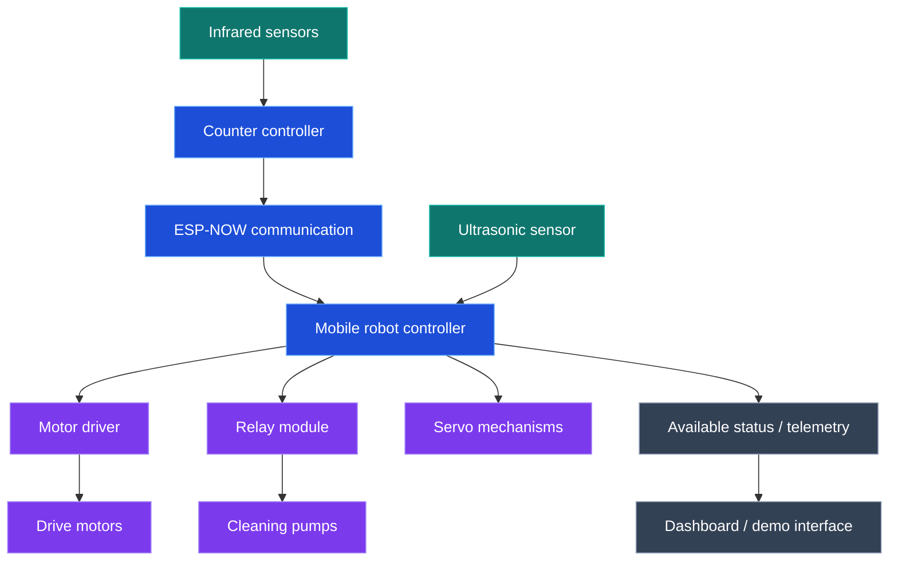

<div align="center">

# AWC · Automatic Washroom Cleaner

### Autonomous robotics for smarter washroom hygiene

A sensor-integrated mobile cleaning robotics prototype built with embedded systems, wireless communication, and electromechanical mechanisms.

<br/>


**Built through experimentation. Improved through iteration. Designed for practical robotics.**

</div>

---

## ✦ At a glance

**AWC (Automatic Washroom Cleaner)** explores how affordable embedded systems and mobile robotics can help automate repetitive cleaning tasks. It brings together sensing, movement, wireless messaging, liquid dispensing, and mechanical actuation in a modular prototype.

| | |
|---|---|
| **Project type** | Educational robotics prototype |
| **Controllers** | ESP32 and ESP8266 |
| **Wireless link** | ESP-NOW |
| **Motion control** | DC motors with an L298N H-bridge driver |
| **Sensing** | Infrared sensors and ultrasonic distance sensing |
| **Cleaning actuation** | Pumps, relay module, and servo mechanisms |
| **Team** | The Clean Coders |
| **Recognition** | 2nd Prize, Junior Working Model · Venad Sahodaya |

> [!NOTE]
> AWC has evolved through multiple hardware and firmware iterations. Pin mappings, communication paths, and supported behaviours can differ between revisions. This README describes the overall architecture, not a guaranteed pinout for every build.

## Contents

- [The problem](#-the-problem)
- [Our approach](#-our-approach)
- [Highlights](#-highlights)
- [Recognition](#-recognition)
- [System architecture](#-system-architecture)
- [Hardware](#-hardware)
- [Software](#-software)
- [How it works](#-how-it-works)
- [Communication](#-communication)
- [Subsystem notes](#-subsystem-notes)
- [Repository layout](#-repository-layout)
- [Setup and installation](#-setup-and-installation)
- [Configuration](#-configuration)
- [Testing and validation](#-testing-and-validation)
- [Safety](#-safety)
- [Engineering challenges](#-engineering-challenges)
- [Roadmap](#-roadmap)
- [Known limitations](#-known-limitations)
- [Contributing](#-contributing)
- [Acknowledgements](#-acknowledgements)
- [License](#-license)

---

## 🎯 The problem

Washroom cleaning is repetitive maintenance work that takes time and physical effort. Automating parts of the process introduces a practical set of engineering challenges:

- Coordinating robot movement with cleaning mechanisms.
- Detecting events using affordable sensors.
- Exchanging messages between multiple microcontrollers.
- Managing the different power demands of motors, pumps, and servos.
- Detecting obstacles and responding safely.
- Keeping the design modular enough to debug, repair, and improve.

Commercial cleaning robots can be expensive or difficult to adapt to educational environments. AWC explores a smaller-scale alternative that can be studied and iterated on with accessible electronics.

## 🧩 Our approach

AWC divides the system into independently testable subsystems:

- **Mobile robotics** provides a motorized platform for movement.
- **Sensor integration** uses infrared sensors for entry/exit counting and ultrasonic sensing for distance measurements.
- **Wireless communication** lets compatible ESP32 and ESP8266 devices exchange supported control messages using ESP-NOW.
- **Cleaning actuation** uses relay-switched pumps and servo-driven mechanisms.
- **Application visualization** provides a way to demonstrate selected status and operational information.

Separating these responsibilities makes debugging easier and gives each subsystem room to evolve.

## ✨ Highlights

### Mobile robotics
- Motorized mobile platform.
- DC motor direction control through an H-bridge driver.
- Separate controller logic for sensing and movement.
- Expandable sensor architecture.

### Sensing
- Two-sensor infrared entry/exit counting subsystem.
- Ultrasonic distance sensing for obstacle detection.
- Architecture designed to accommodate additional sensors.

### Wireless control
- ESP-NOW communication between compatible controllers.
- No conventional Wi-Fi router required for ESP-NOW peer communication.
- Serial `START`/`STOP` fallback in applicable firmware revisions.
- Communication logic separated from actuation logic.

### Cleaning mechanisms
- Pump-based liquid dispensing.
- Relay-controlled pump switching.
- Servo-based mechanical actuation.
- Expandable cleaning-control logic.

### Demonstration interface
The dashboard concept can visualize information such as:

- Robot status.
- Path visualization.
- Counting information.
- Cleaning progression.

Displayed information depends on the interface and telemetry implemented in a particular build. A visual simulation is not proof that a physical action occurred unless the controller provides corresponding feedback.

## 🏆 Recognition

### Venad Sahodaya competition

- **Award:** Second Prize, Junior Working Model
- **Prize:** ₹1,500
- **Team:** The Clean Coders

The team demonstrated the hardware and application concept. Judges discussed practical deployment, sensor usage, and possible real-world applications.

### School Innovation Marathon

AWC reached **finalist status** after progressing through three competition levels. The process provided opportunities to demonstrate the prototype, explain its engineering, and identify areas for improvement.

---

## 🏗️ System architecture

The diagram below represents the **logical architecture**. Exact wiring and responsibilities depend on the firmware and hardware revision.



### Subsystem responsibilities

| Subsystem | Responsibility |
|---|---|
| Counter controller | Reads infrared sensors and manages counting logic |
| Communication layer | Transfers supported messages between controllers |
| Mobile controller | Coordinates movement and supported cleaning operations |
| Motor driver | Controls connected drive motors |
| Ultrasonic sensor | Provides distance measurements |
| Relay module | Switches the pump power circuit |
| Servo mechanisms | Provide controlled mechanical movement |
| Dashboard | Displays available status and demonstration information |

## 🔩 Hardware

The list below describes the known hardware architecture. Quantities and exact configurations can vary between prototypes.

| Component | Role |
|---|---|
| ESP32 development board | Mobile robot controller |
| ESP8266 NodeMCU | Counter/controller subsystem in the relevant build |
| TT geared DC motors | Robot movement |
| L298N motor driver | DC motor direction control |
| Infrared sensor modules | Entry/exit detection |
| Ultrasonic distance sensor | Obstacle detection |
| DC pumps | Liquid dispensing |
| Two-channel relay module | Pump switching |
| Servo motors | Mechanical actuation |
| Voltage converter | Supply voltage regulation |
| Batteries or external supply | System power |
| Chassis and mounting hardware | Mechanical structure |
| Wires and connectors | Electrical interconnections |
| LEDs and supporting electronics | Status indication and auxiliary functions |

### Revision history note

Earlier experiments used a Raspberry Pi-based controller and TCP communication. Those belong to earlier architectural iterations and should **not** be assumed to be part of the current ESP-NOW-based implementation.

### Design philosophy

AWC uses accessible components to simplify prototyping, repair, and experimentation. Its modular structure is intended to let individual components be replaced or upgraded without redesigning the entire robot.

## 💻 Software

| Technology | Purpose |
|---|---|
| Arduino framework | Microcontroller firmware development |
| C/C++ | Embedded programming |
| ESP32 platform | Mobile robot control |
| ESP8266 platform | Counter/controller functionality |
| ESP-NOW | Wireless communication |
| ESP32Servo or compatible library | Servo control |
| GPIO | Sensor inputs and actuator outputs |
| Serial communication | Debugging and supported fallback control |
| HTML, CSS, JavaScript | Dashboard technologies, where applicable |
| Mermaid | Documentation diagrams |

Firmware responsibilities include sensor initialization, infrared event processing, wireless messaging, command validation, motor control, relay switching, servo actuation, system-state management, and diagnostic output.

> **Control boundary:** The dashboard is a presentation layer. Physical operations must remain under embedded-system control and its safety logic.

## ⚙️ How it works

The intended workflow below is conceptual. Actual sequences and completion criteria depend on the firmware revision.

1. **Initialize**  
   Controllers initialize GPIO, sensors, communication interfaces, and supported actuators.

2. **Monitor sensors**  
   The counter controller reads the infrared sensors. Sensor event ordering can help infer direction when placement and logic support it.

3. **Exchange messages**  
   The counter/controller sends supported messages to the mobile robot using ESP-NOW.

4. **Move**  
   The mobile controller sends direction signals to the motor driver, which controls the motors. Actual direction depends on motor wiring and pin mapping.

5. **Check surroundings**  
   The ultrasonic sensor provides distance measurements that can be used for obstacle detection and movement restrictions.

6. **Operate cleaning mechanisms**  
   The controller operates supported pump and servo mechanisms. The relay switches the pump circuit.

7. **Monitor state**  
   Available system information can be shown in the demonstration interface. Status should be based on actual controller data wherever possible.

8. **Stop or reset**  
   The system enters its configured stopped or idle state when applicable conditions are met. Timeouts, completion criteria, and reset behaviour must be defined in firmware.

## 📡 Communication

AWC uses **ESP-NOW**, a connectionless communication protocol provided by Espressif, to exchange small messages between compatible ESP32 and ESP8266 controllers without relying on a conventional wireless access point.

### Why ESP-NOW?

- No conventional Wi-Fi router is required for peer communication.
- Small control messages can be exchanged between compatible devices.
- Communication can be kept separate from motor-control logic.
- The protocol fits compact embedded-system architectures.


The status response in this diagram is optional and depends on the implemented firmware.

### Configuration requirements

Before enabling communication, verify that:

- Both boards support the selected ESP-NOW implementation.
- Peer addressing or broadcast configuration is correct.
- Both devices use compatible wireless channel settings.
- Packet structures and data types match.
- Initialization succeeds on both controllers.
- Received commands are validated before use.

The project has used **channel 1** in an ESP-NOW configuration. Both devices must be configured consistently with the selected channel.

### Reliability considerations

Wireless communication cannot guarantee delivery of every message. A robust implementation should consider:

- Communication timeouts.
- Message validation.
- Duplicate-command handling where necessary.
- Defined behaviour when communication is interrupted.
- A safe stopped state when required messages are unavailable.

The robot should not continue uncontrolled movement simply because an earlier movement command was received successfully.

## 🧰 Subsystem notes

### Motor control

The L298N provides H-bridge control for compatible DC motors. The microcontroller supplies logic signals while the motor supply provides the required power.

Before operation, verify current limits, voltage drop, heat dissipation, motor compatibility, and wiring.

### Infrared counting

The counting subsystem uses two infrared sensors. A two-sensor arrangement can infer direction from event sequences when the sensors are positioned appropriately.

Reliable counting depends on:

- Correct sensor alignment.
- Consistent event detection.
- Appropriate event ordering.
- Filtering repeated or noisy detections.
- Testing under realistic conditions.

Counting accuracy should be measured, not assumed.

### Ultrasonic sensing

The ultrasonic sensor provides distance measurements for obstacle detection. Readings can be affected by object shape, angled surfaces, soft materials, sensor positioning, and environmental conditions.

A single measurement is not proof that a path is clear.

### Pump and relay control

The pump subsystem uses relay-based switching. Relay contacts must be rated for the pump's operating current and startup surge.

The microcontroller should control the relay input rather than power the pump directly from a GPIO pin. Use an appropriate pump supply and suitable electrical protection.

### Servo control

Servo mechanisms provide controlled angular movement. The supply must support the servo's voltage and current requirements without causing controller resets.

A suitable regulated supply and common reference ground are generally required for conventional servo-control wiring. If servo movement causes brownouts, investigate supply capacity, wiring resistance, and current demand before changing software timing.

### Power management

AWC combines logic electronics with motors, pumps, and servos that can have very different current requirements. The power architecture should account for:

- Logic voltage requirements.
- Motor and pump operating current.
- Servo startup and stall current.
- Regulator capacity.
- Common-ground requirements.
- Wiring and connector ratings.
- Electrical noise and voltage transients.

A stable power system is essential for reliable operation.

---

## 📁 Repository layout

The following is a **suggested organization**, not a claim about the repository's current files. Adapt it to match the actual project before publishing.

```text
AWC/
├── README.md
├── firmware/
│   ├── counter/
│   │   └── counter.ino
│   └── robot/
│       └── robot.ino
├── dashboard/
│   └── README.md
├── docs/
│   ├── architecture.md
│   └── testing.md
└── LICENSE
```

Keep the counter and robot firmware separate when they run on different microcontrollers. Avoid committing compiled binaries, credentials, or unrelated build artifacts unless the repository specifically needs them.

## 🚀 Setup and installation

### Prerequisites

- ESP32 development board.
- ESP8266 NodeMCU, if used by the selected build.
- USB data cables.
- Arduino IDE or a compatible development environment.
- Appropriate ESP32 and ESP8266 board packages.
- Required firmware libraries.
- Suitable regulated power supplies.
- Source code for the relevant firmware revision.

### 1. Prepare the development environment

Install the board support packages required by the target microcontrollers. Select the correct board model and serial port, then confirm each board can be programmed independently.

### 2. Prepare the counter subsystem

Connect the infrared sensors according to the selected firmware's pin assignments. Verify their output states individually and test the counting logic before adding wireless communication.

### 3. Prepare the mobile platform

Mount the motors and driver securely. Connect the motor-driver logic pins to the configured controller pins. Confirm motor wiring and power requirements before testing.

### 4. Install the cleaning mechanism

Connect the pumps through appropriately rated switching circuitry. Install the servo mechanisms and verify their power requirements. Test the actuators with the drive motors disabled.

### 5. Configure wireless communication

Configure compatible ESP-NOW settings on both controllers. Check channel selection, addressing, initialization, and packet formats. Use serial diagnostics to identify communication errors.

### 6. Upload firmware

Upload the appropriate firmware to each board. Test each controller independently before running an integrated sequence.

### 7. Integrate the system

Connect subsystems after their individual tests pass. Begin initial motor tests with the robot restrained or its wheels lifted, and use an open, dry testing area.

### 8. Verify operation

Confirm that sensor readings, communication, movement, and actuator behaviour match the intended design. Do not enable unattended operation until relevant failure conditions and safety mechanisms have been tested.

## 🔧 Configuration

Pin mappings may differ between AWC revisions. **Always use the pin definitions in the firmware being compiled.**

A previous mobile-controller configuration used these example assignments:

| Signal | Example GPIO |
|---|---:|
| Motor IN1 | `12` |
| Motor IN2 | `14` |
| Motor IN3 | `26` |
| Motor IN4 | `27` |

The counter subsystem has also used:

| Signal | Example GPIO |
|---|---:|
| Infrared sensor 1 | `13` |
| Infrared sensor 2 | `27` |
| Servo signal | `14` |

These are historical examples, not a universal pinout. GPIO assignments can conflict if code from different revisions is combined.

### Pre-flight checklist

- [ ] Confirm the target board.
- [ ] Verify GPIO assignments.
- [ ] Check sensor output polarity.
- [ ] Verify ESP-NOW channel and peer configuration.
- [ ] Confirm packet compatibility.
- [ ] Check motor direction.
- [ ] Verify pump and relay ratings.
- [ ] Confirm servo voltage and current requirements.
- [ ] Test communication-loss behaviour.
- [ ] Verify safe startup and shutdown states.

## 🧪 Testing and validation

Test each subsystem independently before full integration.

| Test | Expected result |
|---|---|
| Controller startup | Firmware initializes without unexpected resets |
| Infrared sensor test | Sensor readings respond consistently |
| Counting test | Counts match the intended event sequence |
| ESP-NOW test | Compatible controllers exchange valid messages |
| Motor-direction test | Motors move in the intended direction |
| Ultrasonic test | Distance readings respond to nearby obstacles |
| Pump-control test | Relay switches the pump circuit correctly |
| Servo test | Mechanism reaches configured positions |
| Communication-loss test | System enters a defined safe state |
| Power-stability test | Controllers remain stable during actuator operation |
| Integrated-system test | Subsystems operate together without unexpected interference |

### Keep test records

For repeatable testing, record:

- Firmware revision or Git commit.
- Controller models.
- Sensor placement.
- Power-supply configuration.
- Test conditions and expected behaviour.
- Observed behaviour.
- Known failures and limitations.

Record results from actual experiments. Successful compilation alone does not establish that the complete robot operates correctly.

## 🛡️ Safety

AWC is an experimental robotics prototype, **not a certified commercial cleaning machine**.

### Electrical safety
- Disconnect power before modifying wiring.
- Verify supply polarity before connecting components.
- Never power motors, pumps, or high-current servos directly from GPIO pins.
- Use appropriately rated drivers, relays, wires, and connectors.
- Avoid exposed conductive connections and short circuits.
- Investigate controller brownouts during actuator operation.

### Mechanical safety
- Keep fingers, loose wires, and clothing away from moving parts.
- Secure motors, batteries, and mechanisms.
- Test movement in an open area.
- Provide an accessible way to disconnect motor and pump power.
- Prevent uncontrolled movement during debugging.

### Liquid safety
- Protect electronics from water and cleaning liquids.
- Secure pump tubing and liquid containers.
- Test for leaks before powering nearby electronics.
- Do not use untested cleaning chemicals.
- Supervise the prototype during liquid-dispensing tests.

### Operational safety
- Do not leave the prototype operating unattended.
- Test communication failures and unexpected sensor readings.
- Stop the robot if movement or actuator behaviour becomes unpredictable.
- Do not deploy it in public washrooms without appropriate supervision, protection, and validation.

## 🧠 Engineering challenges

### Communication reliability
Wireless links introduce failure modes that do not occur with a simple wired connection. Commands must be validated, and firmware must define what happens when messages stop arriving.

### Power stability
Motors and servos can demand sudden bursts of current. Voltage drops can cause resets or unstable sensor readings when the power architecture is inadequate.

### Sensor accuracy
Infrared counting depends on sensor placement and event handling. Ultrasonic measurements can also be inconsistent under certain physical conditions.

### Hardware and firmware integration
Subsystems can have conflicting pin assignments, timing requirements, or power needs. Modular firmware and documented hardware revisions make issues easier to isolate.

### Prototype evolution
AWC has passed through multiple design iterations. Older firmware and hardware configurations may not match the current build. Documenting revisions helps prevent outdated wiring diagrams or assumptions from being applied to newer hardware.

## 🗺️ Roadmap

These are possible future development directions, **not claims of completed features**.

### Firmware and reliability
- [ ] Standardize message formats between controllers.
- [ ] Improve communication timeout handling.
- [ ] Add explicit system states and error reporting.
- [ ] Improve sensor filtering and counting reliability.
- [ ] Expand diagnostic logging.

### Autonomous navigation
- [ ] Improve obstacle detection.
- [ ] Evaluate repeatable movement paths.
- [ ] Investigate localization and path-planning approaches.
- [ ] Add additional sensing where justified.

### Cleaning mechanism
- [ ] Improve liquid-dispensing consistency.
- [ ] Evaluate cleaning coverage.
- [ ] Improve leak protection.
- [ ] Develop a repeatable cleaning sequence.

### Application interface
- [ ] Improve live status reporting.
- [ ] Distinguish simulated progress from confirmed physical state.
- [ ] Add clear error and connection indicators.
- [ ] Improve visualization of sensor and robot state.

### Hardware
- [ ] Improve power distribution.
- [ ] Refine cable management.
- [ ] Evaluate a consolidated PCB.
- [ ] Improve protection of electronics from liquid exposure.
- [ ] Document final hardware revisions.

## ⚠️ Known limitations

AWC remains a prototype. Capabilities depend on the particular hardware and firmware revision.

- Obstacle detection does not guarantee complete obstacle avoidance.
- Infrared counting accuracy depends on sensor positioning and event logic.
- Wireless communication may be interrupted.
- Pump performance depends on the pump, liquid, tubing, and power supply.
- Cleaning effectiveness requires separate testing and validation.
- Dashboard visualization does not guarantee successful physical execution.
- The prototype is not certified for unsupervised commercial deployment.

These limitations are also useful targets for future engineering and validation.

## 🤝 Contributing

Suggestions and contributions are welcome in areas such as:

- Embedded firmware.
- Sensor integration.
- Communication reliability.
- Motor control.
- Power management.
- Mechanical design.
- Dashboard development.
- Documentation and testing.

### Suggested workflow

1. Fork the repository.
2. Create a branch for your change.
3. Make a focused modification.
4. Test it on the relevant hardware or in an appropriate simulation.
5. Document hardware assumptions and limitations.
6. Submit a pull request describing the change and its test results.

Please do not include credentials, private network information, or other secrets in source code.

## 🙌 Acknowledgements

AWC grew through hands-on experimentation with embedded systems, robotics, electronics, and mechanical integration.

Thank you to everyone who supported the project, the competition organizers and judges who evaluated the prototype, and everyone who offered feedback during development.

Special recognition goes to **The Clean Coders** for the Venad Sahodaya competition demonstration.

## 📜 License

**Copyright (c) 2026 Afraz Akbar. All rights reserved.**

This project and its source code are proprietary and protected under copyright law. No permission is granted to use, copy, modify, merge, publish, distribute, sublicense, or sell copies of this software or hardware design without explicit written permission from the copyright holder.

See [`LICENSE`](LICENSE) for details.

Third-party libraries used by the project, such as `ESP32Servo`, remain subject to their respective licenses.

---

<div align="center">

### AWC · Automatic Washroom Cleaner

**Sensing. Communicating. Moving. Cleaning.**

*An ongoing exploration of affordable robotics and embedded automation.*

💀 **Built by The Clean Coders**

</div>
